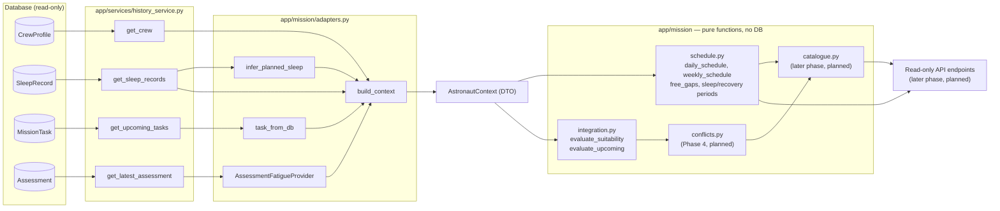

# Phase 3 — Schedule Management and Health-Mission Integration

Status: implementation + tests complete for Phase 3. No database schema, model,
router, or service outside `backend/app/mission/` was changed.

Scope of this phase:

- `app/mission/schedule.py` — pure schedule views and free-gap computation (no DB access).
- `app/mission/integration.py` — task-suitability rules and upcoming-task evaluation.
- New DTOs in `app/mission/models.py` — `SuitabilityStatus`, `SuitabilityResult`, `FreeGap`.
- New thresholds in `app/mission/config.py` — free-gap minimum and the two sleep-shortfall ratios.
- Tests — `app/mission/tests/test_schedule.py`, `app/mission/tests/test_integration.py`.

All numeric values below are **configurable assumptions** (`docs/01_references.md` states
no numeric threshold). The sources support the *concepts* only — sleep opportunity,
cumulative sleep loss, workload, and human-in-the-loop review — not any cut-off.

---

## 1. Data flow



Legend: solid arrows are implemented in Phase 2/3; nodes marked *planned* are not part of
this phase. `integration.py` and `schedule.py` never import a session or write to the
database.

---

## 2. Schedule module — input / output specification

All windows are half-open UTC intervals `[start, end)`. Naive datetimes are rejected.

| Function | Inputs | Output | Behavior |
| --- | --- | --- | --- |
| `day_bounds(day)` | `date` or aware `datetime` | `(start, end)` aware UTC | A `datetime` is normalised to UTC before taking its calendar day. |
| `week_bounds(week_start)` | `date` or aware `datetime` | 7-day `(start, end)` | Starts at UTC midnight. |
| `daily_schedule(tasks, day)` | iterable of `TaskView`, day | `dict[astronaut_id, list[TaskView]]` | Only tasks overlapping the day; each list sorted by `(start_time, task_id)`; astronauts sorted by id. A midnight-crossing task appears on both days. |
| `weekly_schedule(tasks, week_start)` | iterable of `TaskView`, week start | `dict[astronaut_id, list[TaskView]]` | Same rules over seven days. |
| `priority_rank(priority)` | `Priority` | `int` | `critical=4, high=3, medium=2, low=1`. |
| `sort_by_priority(tasks)` | iterable of `TaskView` | `list[TaskView]` | Most urgent first, then earliest, then id. |
| `group_by_category(tasks)` | iterable of `TaskView` | `dict[TaskCategory, list[TaskView]]` | Every enum key present (possibly empty); values sorted by start. |
| `group_by_priority(tasks)` | iterable of `TaskView` | `dict[Priority, list[TaskView]]` | Every enum key present; values sorted by start. |
| `sleep_periods(tasks)` | iterable of `TaskView` | `list[TaskView]` | Category `sleep`, sorted by start. |
| `recovery_periods(tasks)` | iterable of `TaskView` | `list[TaskView]` | Categories `rest` and `rest_recovery`, sorted by start. |
| `sleep_and_rest_periods(tasks)` | iterable of `TaskView` | `(sleep, recovery)` | Convenience wrapper. |
| `free_gaps(tasks, window_start, window_end, config, min_minutes=None)` | one astronaut's tasks, window, config | `list[FreeGap]` | Clips to window, merges overlapping/touching tasks, omits gaps shorter than `MIN_FREE_GAP_MINUTES` (or explicit `min_minutes`). |

Sleep is never assumed to occur at a global clock time: a "sleep period" is simply a task
whose category is `sleep`, so each astronaut may have a different pattern.

`FreeGap` output fields: `start_time`, `end_time`, computed `duration_minutes`.

---

## 3. Suitability module — input / output specification

`evaluate_suitability(context, task, config=DEFAULT_CONFIG) -> SuitabilityResult`

### 3.1 Inputs

| Input | Source | Required? | Used as |
| --- | --- | --- | --- |
| `context.fatigue_signal.level` | latest `Assessment.status` via adapter | **Yes** | Categorical fatigue level. `unknown` means missing data. |
| `context.recent_sleep` | valid `SleepRecord` rows | **Yes** | Latest record by `end_time`; its `duration_minutes` is compared with the target. |
| `context.crew.sleep_target_hours` | `CrewProfile` | **Yes** | Target sleep in minutes (×60). Must be > 0. |
| `context.planned_sleep_windows` | `infer_planned_sleep` | No | Empty means "no known plan", not missing data. Overlap is checked exactly. |
| `task.required_alertness` | derived by adapter | No | `None` is accepted; `>= CRITICAL_TASK_ALERTNESS_REQUIREMENT` makes the task demanding. |
| `task.priority`, `task.workload_level`, `task.is_critical` | adapter mapping | Yes (fields exist) | Determine whether the task is *demanding*. |
| `task.category` | DB `TaskType` mapping | Yes | Sleep/rest/recovery tasks are exempt from the planned-sleep overlap rule. |
| `task.start_time`, `task.end_time` | DB | Yes | Overlap test with planned sleep windows. |
| `task.astronaut_id` | DB `crew_id` | Yes | Must equal `context.crew.crew_id`, otherwise `ValueError`. |

`demanding` is true when **any** of: `is_critical`, priority `critical`, workload in
`DEMANDING_WORKLOAD_LEVELS` (default `high`), or required alertness
`>= CRITICAL_TASK_ALERTNESS_REQUIREMENT` (default 4).

### 3.2 Output — `SuitabilityResult`

| Field | Type | Meaning |
| --- | --- | --- |
| `task_id` | `str` | Evaluated task. |
| `astronaut_id` | `str` | Context owner. |
| `status` | `SuitabilityStatus` | `suitable`, `review`, `not_recommended`, or `insufficient_data`. |
| `reasons` | `list[str]` | Human-readable findings prefixed with the rule id. Never empty. |
| `rule_ids` | `list[str]` | Triggered rule ids in the same order as `reasons`. |
| `inputs_used` | `dict` | Exact values and threshold snapshot used, plus `missing_inputs` for insufficient data. |

`evaluate_upcoming(context, config)` evaluates all context tasks that are not `completed`
or `cancelled`, in start order (ties by task id). It returns `list[SuitabilityResult]`.

### 3.3 Rules

Status is the highest severity found: severity 3 → `not_recommended`; severity 1–2 →
`review`; no finding → `suitable`. Findings are ordered by severity descending, then by
rule id.

| Rule | Condition | Severity / status | Threshold (configurable assumption) |
| --- | --- | --- | --- |
| `R-DATA-01` | Fatigue level `unknown`, no recent sleep, or sleep target ≤ 0 | `insufficient_data` | — |
| `R-FATIGUE-01` | `elevated_concern` and demanding task | 3 → `not_recommended` | — |
| `R-FATIGUE-02` | `elevated_concern` and non-demanding task | 2 → `review` | — |
| `R-FATIGUE-03` | `monitor` and demanding task | 2 → `review` | — |
| `R-FATIGUE-04` | `monitor` and non-demanding task | 1 → `review` | — |
| `R-SLEEP-01` | last sleep / target < `SLEEP_SHORTFALL_NOT_RECOMMENDED_RATIO` | 3 if demanding, else 2 | `0.75` |
| `R-SLEEP-02` | ratio ≥ not-recommended ratio, but < `SLEEP_SHORTFALL_REVIEW_RATIO`, and demanding | 2 → `review` | `0.90` |
| `R-SLEEP-03` | task overlaps a planned sleep window and is not a sleep/rest/recovery task | 3 → `not_recommended` | exact overlap (no tolerance) |
| `R-OK-01` | no other rule triggered | → `suitable` | — |

Notes:

- A ratio at or above `0.90` is treated as adequate for these rules; no finding is raised.
- `R-SLEEP-02` intentionally applies to demanding tasks only, to avoid noise for routine work.
- `R-SLEEP-03` exempts `sleep`, `rest`, and `rest_recovery` because occupying a sleep window
  is precisely their purpose.
- `insufficient_data` is exclusive: the function returns before any suitability finding is
  computed, so it can never also be `suitable` or `review`.

### 3.4 Thresholds added in Phase 3

| Config field | Default | Label |
| --- | --- | --- |
| `MIN_FREE_GAP_MINUTES` | 15 | configurable assumption |
| `SLEEP_SHORTFALL_NOT_RECOMMENDED_RATIO` | 0.75 | configurable assumption |
| `SLEEP_SHORTFALL_REVIEW_RATIO` | 0.90 | configurable assumption |

The config validator requires `0 < not_recommended < review ≤ 1`.

---

## 4. Worked numeric examples

All four examples use `DEFAULT_CONFIG` (target 7.5 h = 450 min, review ratio 0.90,
not-recommended ratio 0.75, demanding workloads = `high`, critical alertness requirement 4).
Outputs below were generated by running `evaluate_suitability` on the listed inputs.

### Example A — `suitable`

Inputs:

- Fatigue level: `no_flag`.
- Last sleep: 465 min (22:15 → 06:00 UTC), target 450 min → ratio 465/450 = **1.033**.
- Task `task-a`: maintenance, 09:00–10:30 UTC, workload `medium`, required alertness 3,
  priority `medium`, not critical.
- No planned sleep windows.

Reasoning: ratio ≥ 0.90; `no_flag`; non-demanding; no overlap → no rule fires.

```json
{
  "task_id": "task-a",
  "status": "suitable",
  "reasons": ["R-OK-01: no configured suitability rule was triggered."],
  "rule_ids": ["R-OK-01"],
  "inputs_used": {
    "fatigue_level": "no_flag",
    "last_sleep_minutes": 465,
    "sleep_target_minutes": 450,
    "sleep_ratio": 1.033,
    "required_alertness": 3,
    "priority": "medium",
    "workload_level": "medium",
    "is_critical": false,
    "demanding": false,
    "overlaps_planned_sleep": false
  }
}
```

### Example B — `review`

Inputs:

- Fatigue level: `monitor`.
- Last sleep: 400 min, target 450 → ratio 400/450 = **0.889** (below 0.90, above 0.75).
- Task `task-b`: 13:00–15:00 UTC, workload `high`, required alertness 5, priority `high`
  → demanding.
- No planned sleep windows.

Reasoning: `R-FATIGUE-03` (severity 2) and `R-SLEEP-02` (severity 2) → highest severity 2 →
`review`.

```json
{
  "task_id": "task-b",
  "status": "review",
  "reasons": [
    "R-FATIGUE-03: Fatigue level 'monitor' combined with a demanding task warrants review.",
    "R-SLEEP-02: Last sleep 400 min is 89% of the 450 min target, below the 90% review ratio for a demanding task."
  ],
  "rule_ids": ["R-FATIGUE-03", "R-SLEEP-02"],
  "inputs_used": {
    "fatigue_level": "monitor",
    "last_sleep_minutes": 400,
    "sleep_target_minutes": 450,
    "sleep_ratio": 0.889,
    "required_alertness": 5,
    "priority": "high",
    "workload_level": "high",
    "demanding": true,
    "overlaps_planned_sleep": false
  }
}
```

### Example C — `not_recommended`

Inputs:

- Fatigue level: `elevated_concern`.
- Last sleep: 330 min, target 450 → ratio 330/450 = **0.733** (below 0.75).
- Task `task-c`: EVA, 21:00–23:00 UTC, workload `high`, required alertness 5, priority
  `critical`, `is_critical=True`.
- Planned sleep window: 22:00 (13 Nov) → 06:00 (14 Nov) UTC, so the task overlaps it by
  60 min.

Reasoning: `R-FATIGUE-01`, `R-SLEEP-01`, and `R-SLEEP-03` each have severity 3 →
`not_recommended`.

```json
{
  "task_id": "task-c",
  "status": "not_recommended",
  "reasons": [
    "R-FATIGUE-01: Fatigue level 'elevated_concern' combined with a demanding task is not recommended.",
    "R-SLEEP-01: Last sleep 330 min is 73% of the 450 min target, below the 75% not-recommended ratio.",
    "R-SLEEP-03: Task overlaps planned sleep window(s): 2026-11-13T22:00:00+00:00 to 2026-11-14T06:00:00+00:00."
  ],
  "rule_ids": ["R-FATIGUE-01", "R-SLEEP-01", "R-SLEEP-03"],
  "inputs_used": {
    "fatigue_level": "elevated_concern",
    "last_sleep_minutes": 330,
    "sleep_target_minutes": 450,
    "sleep_ratio": 0.733,
    "required_alertness": 5,
    "priority": "critical",
    "workload_level": "high",
    "is_critical": true,
    "demanding": true,
    "overlaps_planned_sleep": true
  }
}
```

### Example D — `insufficient_data` (missing-data behavior, not a numeric case)

Inputs: fatigue level `unknown`; last sleep 465 min; otherwise identical to Example A.

Reasoning: `R-DATA-01` returns immediately. The result reports what is missing and makes no
suitability judgement.

```json
{
  "task_id": "task-d",
  "status": "insufficient_data",
  "reasons": [
    "R-DATA-01: missing required input(s): fatigue_signal.level; no suitability judgement is made."
  ],
  "rule_ids": ["R-DATA-01"],
  "inputs_used": {
    "fatigue_level": "unknown",
    "last_sleep_minutes": 465,
    "sleep_target_minutes": 450,
    "sleep_ratio": 1.033,
    "missing_inputs": ["fatigue_signal.level"]
  }
}
```

---

## 5. Scientific framing and limitations

1. These are advisory rules, not a diagnosis or a performance prediction. Final authority
   remains with the crew, flight surgeon, and mission control
   (`NASA-STD-3001-Vol2`, human-in-the-loop principle).
2. The sources support the concepts of sleep opportunity, cumulative sleep loss, workload,
   and circadian timing, but define **no numeric threshold**. Every number in Section 3 is a
   configurable assumption and must not be presented as a NASA finding.
3. No numeric fatigue score is produced. The fatigue input is categorical and `unknown`
   remains `unknown`.
4. Phase 3 emits no countermeasures. When recommendations are added in a later phase, they
   must use "may reduce risk under rule X" wording and may only use the seven countermeasures
   in `02_requirements.md`.
5. Only the latest recorded sleep interval is compared with the target. It is recorded sleep,
   not a planned sleep opportunity, and it may be a nap or an interrupted interval.
6. `planned_sleep_windows` are inferred from habitual sleep records. If inference returns
   nothing, overlap cannot be checked and the result may be more permissive; this is visible
   in `inputs_used["overlaps_planned_sleep"]` and in an empty `planned_sleep_windows` list.
7. All times are UTC. Crew-local time zones are not modelled, so the inferred sleep window
   and any clock-time interpretation may not match the crew's local day.
8. The rules are deterministic and offline; identical inputs produce identical results.
