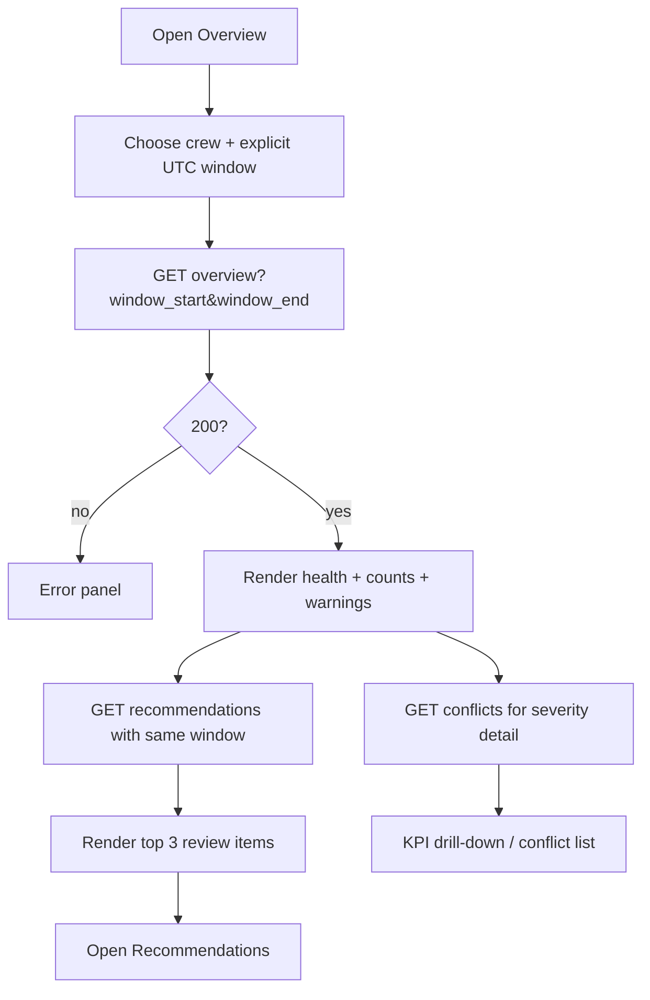
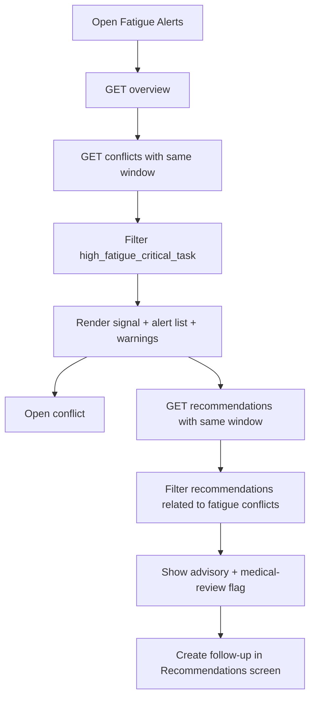
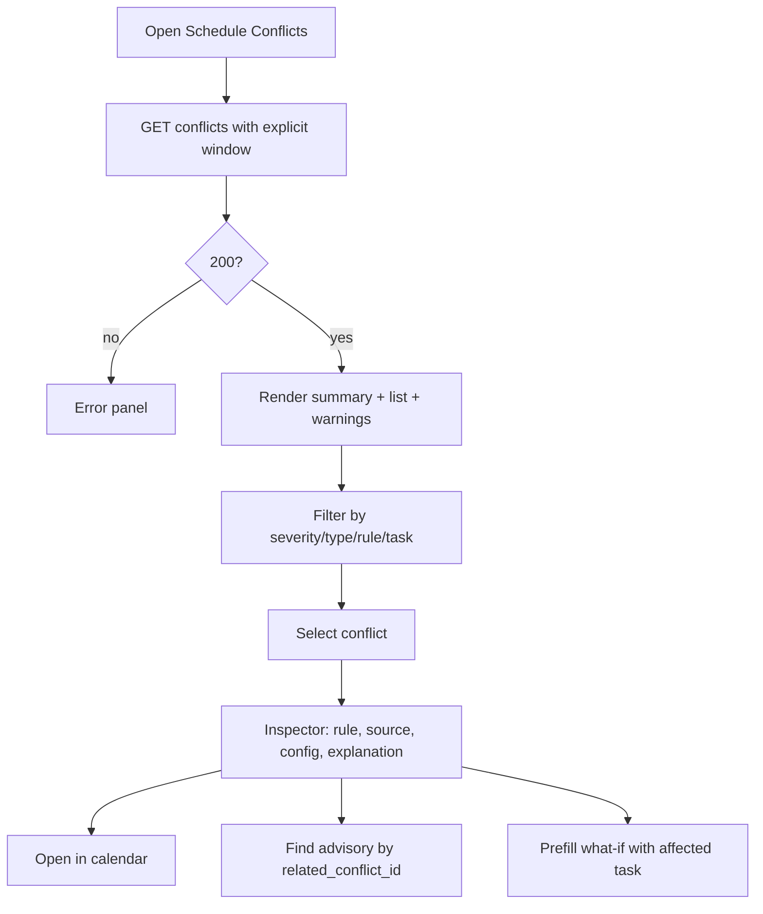
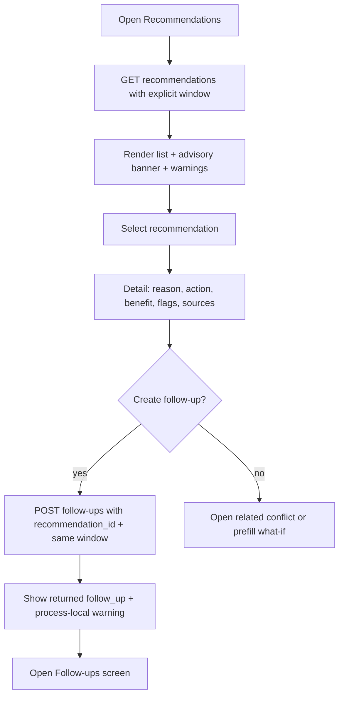
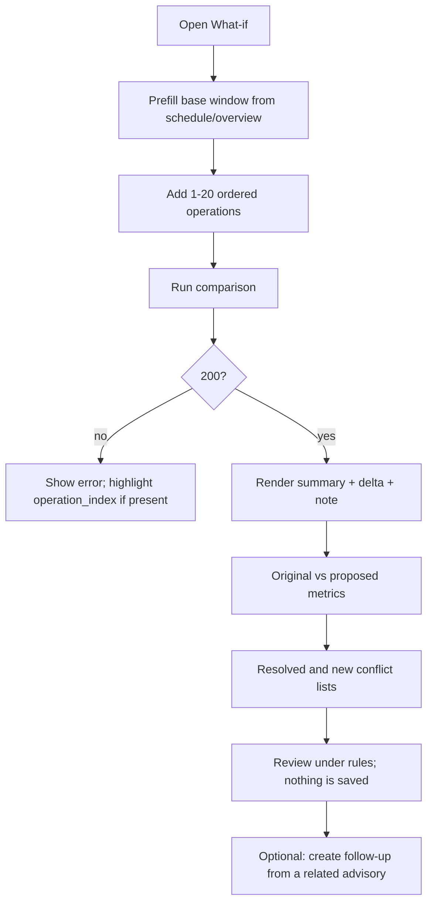
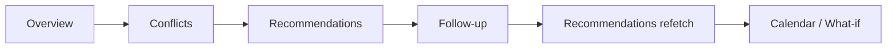
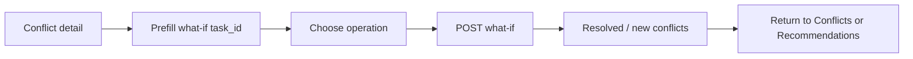

# Phase 9 — UX/UI Specification: Mission Intelligence

Status: **documentation only**. This document specifies screens, states, and API
bindings for Person 1 (React). It does not add React code and does not change the
Phase 7 HTTP contract. All endpoints and fields named here exist in
`app/mission/router.py`, `app/mission/api_models.py`, and
`app/mission/models.py`.

The mission-intelligence router is registered in
`backend/app/routers/__init__.py` and is reachable through `app.main:app` under
`/api/v1`. The end-to-end tests also mount it explicitly so they remain
independent of the registry.

This is **decision support**, not a medical device, diagnosis, fitness-for-duty
determination, or treatment plan. No screen may claim that a schedule change
improves fatigue. Use review-oriented wording only.

---

## 1. Design frame

### 1.1 User and job

The primary user is a mission planner, flight controller, or crew member
reviewing a schedule before approval. The job is:

1. See the schedule and the health inputs the rules actually used.
2. See explainable rule findings, not a black-box score.
3. Review advisory countermeasures and decide what a human wants to do next.
4. Test a transient schedule edit without saving it.
5. Record an advisory follow-up decision.

The system never dispatches, approves, or changes a mission task. Follow-up
actions are bookkeeping only.

### 1.2 Non-negotiable UI rules

| Rule | Requirement |
| --- | --- |
| Decision support | Every risk surface carries the label “Advisory decision support” or equivalent. |
| No diagnosis | Never show “diagnosis”, “condition”, “fit for duty”, “unfit”, “medically cleared”, or a clinical interpretation. |
| No medication | Never show medication, dosage, treatment, or “take” advice. |
| No invented fatigue score | The API has no numeric fatigue score. Display the categorical `fatigue_signal.level` and its `source`; never synthesise a percentage, gauge, or index. |
| No “improves fatigue” | Use “may reduce risk under rule X” and “rule-based schedule metric”. A what-if comparison is not a fatigue prediction. |
| Missing data is visible | `data_warnings` must be shown, not swallowed. “No conflict” is not “safe”. |
| Traceability | Every conflict and recommendation exposes `rule_id`, and its `source_ids` / `config_keys` where available. |
| UTC is explicit | Every time is labelled `UTC`. If a local conversion is offered, show both and label the conversion. |
| Colour is not the only signal | Severity and status always use an icon + text + colour. |
| Human authority | `requires_mission_approval` and `requires_medical_review` are visible before any action. |

### 1.3 Terminology shown to users

| API value | UI label | Notes |
| --- | --- | --- |
| `unknown` | **Unknown — data unavailable** | Never render as green, “safe”, or “no fatigue”. |
| `no_flag` | **No flag recorded** | Does not mean rested or safe. |
| `monitor` | **Monitor** | Advisory state. |
| `elevated_concern` | **Elevated concern — review advised** | Highest categorical input. Not a diagnosis. |
| `suitable` | **Suitable under rules** | Rule result, not a fitness determination. |
| `review` | **Review advised** | |
| `not_recommended` | **Not recommended under rules** | |
| `insufficient_data` | **Insufficient data** | No judgement was made. |
| `low` / `medium` / `high` / `critical` | **Low / Medium / High / Critical** | Severity or priority; always pair with text. |
| `suggested` | **Suggested** | Follow-up starts here. |
| `accepted` | **Accepted** | Advisory decision recorded; nothing applied. |
| `skipped` | **Skipped** | Terminal. |
| `completed` | **Completed** | Terminal; may require approval. |

### 1.4 Layout system

Reuse the existing Cosmos Hub shell (dark space background, glass panels,
mini-orbit navigation, keyboard support, “Simple navigation” and “Reduce
effects” toggles from `frontend/README.md`). The values below are layout
requirements, not a new visual identity.

| Region | Desktop | Tablet | Mobile |
| --- | --- | --- | --- |
| Global top bar | 64 px, full width | 64 px | 56 px |
| Left mission nav | 248 px expanded, 72 px collapsed | 72 px | Hidden behind a drawer |
| Main content | Fluid, max 1440 px | Fluid | Single column |
| Right inspector | 360 px, optional | Overlay drawer | Full-screen sheet |
| Content gutter | 24 px | 16 px | 12 px |
| Grid | 12 columns, 24 px gap | 8 columns, 16 px gap | 4 columns, 12 px gap |
| Radius | 12 px panels, 8 px controls | Same | Same |
| Spacing scale | 4, 8, 12, 16, 24, 32, 48 | Same | Same |

Global top bar contains: breadcrumb (`Hub › Mission intelligence › <screen>`),
crew selector, UTC mission clock, active evaluation window, global warning
count, refresh, and the “Advisory decision support” pill. The crew selector must
not invent a crew list endpoint; use the existing application crew source.

Mission navigation order matches this document:

1. Health-Mission Overview
2. Mission Calendar
3. Upcoming Tasks
4. Fatigue Alerts
5. Schedule Conflicts
6. Recommendations
7. What-if Analysis
8. Follow-ups

Count badges are allowed only when the count comes from an API field
(`conflict_count`, `recommendation_count`) or a client-side count of records
already fetched. Do not invent counts.

### 1.5 Shared components

| Component | Purpose | Required fields | States / behaviour |
| --- | --- | --- | --- |
| `MissionHeader` | Crew, evaluation window, UTC, refresh, advisory pill | `crew.crew_id`, `crew.display_name`, `window_start`, `window_end` | Sticky; refresh disabled while loading; window is always explicit for scenario data. |
| `DataWarningBanner` | Show `data_warnings` without hiding them | `code`, `message`, `rule_id`, `task_id` | Collapsible list; count in header; warning codes map to copy in §11.3. Unknown codes show the raw message. |
| `StatePanel` | One shared loading / empty / error / unavailable surface | `kind`, title, body, action | Skeleton for loading; neutral illustration for empty; error envelope for failure; `unknown-data` uses a dashed border and “No judgement was made”. |
| `SeverityBadge` | Severity with icon + text | `severity` | `critical` = stop/alert icon; `high` = warning; `medium` = info; `low` = dot. Never colour-only. |
| `RuleChip` | Rule traceability | `rule_id` | Tooltip/popover shows `source_ids` and `config_keys` when present. |
| `SourceChip` | Evidence traceability | `source_ids[]` | Human-readable source names from `docs/01_references.md`; never invent a new source. |
| `UtcTimestamp` | Consistent time rendering | ISO datetime | Show `YYYY-MM-DD HH:mm UTC`; optional local time in a secondary line labelled “local”. |
| `DurationLabel` | Consistent durations | `duration_minutes` | Show `1 h 30 min`; zero-duration conflict markers show `0 min gap`. |
| `FreshnessNote` | Explain data recency | `source`, `created_at` if available | The API exposes assessment `source` (id) but not assessment `created_at`; do not invent a freshness badge unless the field is added. |
| `FollowUpStatusPill` | Follow-up lifecycle | `status` | Suggested / Accepted / Skipped / Completed with icon + text. |
| `ApprovalGate` | Human approval before completion | `requires_mission_approval`, `requires_medical_review` | Requires explicit confirmation; `approved=true` is sent only after confirmation. |
| `MetricDelta` | Rule-based what-if delta | `conflict_count_delta` | Text says “fewer conflicts under configured rules”, never “better” or “improved fatigue”. |
| `UnknownDataCard` | Explicit no-judgement state | warning code/message | Used whenever fatigue, sleep, or sleep windows are absent. |

### 1.6 Universal state contract

Every screen must implement these four states. “Unknown data” is distinct from
“empty”: empty means the request succeeded and returned no rows; unknown means
one or more required inputs were unavailable and a rule made no judgement.

| State | Visual | Copy pattern | Behaviour |
| --- | --- | --- | --- |
| Loading | Skeletons matching final layout; no spinner-only page | “Loading mission intelligence…” | Keep previous data visible with a subtle busy overlay if refetching. |
| Empty | Neutral panel, no risk colour | “No <items> in this window.” + the reason if known | Never say “all clear”, “safe”, or “no risk”. |
| Error | Error panel with code and retry | Use `error.code` and `error.message`; add a plain-language action | Retry only for network/5xx. Do not retry 404/422. |
| Unknown data | Dashed-border panel with warning icon | “Data unavailable — no judgement was made.” + warning messages | Disable any conclusion that depends on the missing input. |

### 1.7 Data-warning behaviour

`data_warnings` is present on every successful response and is `[]` on errors.
Rules for the UI:

- Always render a compact warning strip when `data_warnings.length > 0`.
- Do not merge warnings into a generic “info” toast that disappears.
- Do not hide warnings behind a tooltip only; the strip is persistent for the
  current view.
- If `no_assessment_available`, `assessment_insufficient_data`, or
  `no_recent_sleep` is present, the fatigue/sleep cards switch to the
  unknown-data treatment.
- If `no_tasks_in_window` is present, the calendar/task list empty state must
  say that the window contains no tasks that **start** inside it. It must not
  claim the crew has no work.
- `conflict_data_warning` carries `rule_id` and optionally `task_id`; link the
  warning to the matching conflict card or task row when the id is present.
- `follow_up_store_is_process_local` is shown on the Follow-up screen as a
  persistent limitation notice.

---

## 2. Screen 1 — Mission Calendar

### 2.1 Purpose

Answer: “What is scheduled, when is the protected sleep opportunity, and where
do rule findings land on the timeline?”

The calendar is a read-only view. It does not create, move, or approve tasks.

### 2.2 Figma-ready wireframe

Desktop, daily view:

```text
┌──────────────────────────────────────────────────────────────────────────────┐
│ TOP BAR  breadcrumb · crew selector · UTC clock · window · warnings · refresh│ 64
├──────────────┬───────────────────────────────────────────────────────────────┤
│ LEFT NAV     │ SCREEN HEADER                                                 │
│ 248          │ Mission calendar                         [Today] [<] [>]      │
│              │ 2026-11-13 · UTC             [Daily | Weekly]  [Warnings 0]   │
│              ├───────────────────────────────────────────────────────────────┤
│ Overview  ●  │ TOOLBAR  Legend: ■ task  ▒ sleep  ▲ conflict  ─ now          │
│ Calendar  ●  │                                                               │
│ Tasks        ├───────────────────────────────────────────────┬───────────────┤
│ Fatigue      │ TIME   │ DAY COLUMN (or 7 columns weekly)     │ INSPECTOR 360 │
│ Conflicts    │ 00:00  │ ▒▒▒▒▒▒▒▒ sleep band 22:00–06:00      │ Selected item │
│ Recommendations│ 02:00│ ▒▒▒▒▒▒▒▒                             │ Task / sleep  │
│ What-if      │ 04:00  │ ▒▒▒▒▒▒▒▒                             │ / conflict    │
│ Follow-ups   │ 06:00  │ ┌──────────────┐                     │ details       │
│              │ 08:00  │ │ Task block   │  ▲ conflict marker   │               │
│              │ 10:00  │ └──────────────┘                     │               │
│              │ 12:00  │ ...                                  │               │
│              │ 22:00  │ ▒▒▒▒▒▒▒▒ sleep band                  │               │
│              ├───────────────────────────────────────────────┴───────────────┤
│              │ WARNING STRIP (persistent while warnings exist)               │
└──────────────┴───────────────────────────────────────────────────────────────┘
```

Weekly view uses seven equal day columns with a shared 24-hour ruler; it is not
forced to Monday. The requested date is the first day.

Mobile: replace the timeline with an agenda list grouped by hour. A mini 24-hour
strip may remain as an overview. Do not compress seven columns into a phone.

Inspector regions:

1. **Identity**: task name, task id, category, priority, workload, alertness.
2. **Time**: start/end UTC, duration, overlap with sleep window.
3. **Rule markers**: severity, rule ids, short explanation, “Open conflict”.
4. **Actions**: “View task details”, “Open related advisories”, “Prefill what-if”
   (only for a task id; no automatic edit).

### 2.3 Components

| Component | Fields | Behaviour |
| --- | --- | --- |
| `DateStepper` | `date` query | Previous/next day or week; “Today” uses UTC date. |
| `ViewToggle` | `view=daily|weekly` | Changing the view refetches with the same anchor date. |
| `TimelineRuler` | `window_start`, `window_end` | 24-hour ruler; labels in UTC. |
| `SleepBand` | `planned_sleep_windows[]` | Rendered behind tasks as a hatched band; label shows `source` and `duration_minutes`. |
| `TaskBlock` | `tasks[]` | Position by `start_time`/`end_time`; label name + duration; `is_critical` gets an icon, not just a colour. |
| `ConflictMarker` | `conflicts[]` | Small marker at `affected_start`; zero-duration conflicts render as a pin, not a block. |
| `NowLine` | current UTC time | Hidden when “now” is outside the window. |
| `TaskInspector` | selected task | Read-only; “Prefill what-if” only fills the editor, never submits. |
| `CalendarLegend` | static | Explains task, sleep, conflict, now. |

### 2.4 States

| State | Behaviour |
| --- | --- |
| Loading | 24-row ruler skeleton + 3 block skeletons; header controls disabled. |
| Empty | “No mission tasks start in this window.” Show sleep bands if present. If `no_tasks_in_window`, show the warning; do not say “free day”. |
| Error | `404 crew_not_found`: “Crew not found”; offer crew selector/back. `422 validation_error`: show the bad `date`/`view`; keep the previous valid view. Network: retry. |
| Unknown data | If `no_planned_sleep_window`, the calendar still renders tasks but the sleep layer shows “Sleep window unavailable — inferred window could not be built.” The circadian rule used a configured fallback; say so via the warning. If fatigue is unknown, task blocks do not get a fatigue badge; the inspector links to Fatigue Alerts. |

### 2.5 User flow

```mermaid
flowchart TD
    A[Open Mission Calendar] --> B[Read crew + UTC date from shell]
    B --> C[GET schedule?view=daily|weekly&date=YYYY-MM-DD]
    C --> D{200?}
    D -- no --> E[Render error envelope + retry when appropriate]
    D -- yes --> F[Render timeline, task blocks, sleep bands]
    F --> G[GET conflicts with schedule.window_start/window_end]
    G --> H[Overlay conflict markers + warning strip]
    H --> I[Select task or marker]
    I --> J[Inspector: details, rules, sources]
    J --> K[Open conflict / prefill what-if]
```

### 2.6 API needs

`GET /api/v1/crew/{crew_id}/mission-intel/schedule`

| Query | Type | Required | UI use |
| --- | --- | --- | --- |
| `view` | `daily` or `weekly` | No (default `daily`) | Toggle. |
| `date` | `YYYY-MM-DD` | No (default today UTC) | Date stepper; weekly starts on this date. |

| Display element | Field |
| --- | --- |
| Crew id | `crew_id` |
| Window | `window_start`, `window_end` |
| Task block | `tasks[].task_id`, `name`, `category`, `start_time`, `end_time`, `duration_minutes`, `priority`, `workload_level`, `required_alertness`, `is_critical`, `status` |
| Sleep band | `planned_sleep_windows[].start_time`, `end_time`, `duration_minutes`, `source` |
| Warning strip | `data_warnings[].code`, `message`, `rule_id`, `task_id` |

Conflict overlay uses
`GET /api/v1/crew/{crew_id}/mission-intel/conflicts` with
`window_start=schedule.window_start` and `window_end=schedule.window_end`;
fields `conflicts[].conflict_id`, `severity`, `conflict_type`, `rule_id`,
`task_ids`, `affected_start`, `affected_end`, `explanation`, and
`suggested_action`. The inspector shows the full conflict fields.

Known contract limitation: only tasks that **start** inside the window are
loaded. A task that starts before the window and overlaps into it is not
returned. The UI must not present the calendar as a complete overlap query.

---

## 3. Screen 2 — Health-Mission Overview

### 3.1 Purpose

Answer: “What is the crew’s categorical fatigue input, what did the latest
assessment and sleep records show, and how many rule findings need review?”

This is the landing screen for mission intelligence.

### 3.2 Figma-ready wireframe

```text
┌──────────────────────────────────────────────────────────────────────────────┐
│ TOP BAR                                                                      │
├──────────────┬───────────────────────────────────────────────────────────────┤
│ LEFT NAV     │ SCREEN HEADER                                                 │
│              │ Health–Mission Overview        [Window picker] [Refresh]       │
│              │ Mira Sol · Commander · sleep target 8.0 h · window UTC        │
│              ├───────────────────────────────────────────────────────────────┤
│              │ KPI ROW                                                       │
│              │ ┌──────────┐ ┌──────────┐ ┌──────────┐ ┌──────────┐             │
│              │ │ Fatigue  │ │ Latest   │ │ Conflicts│ │ Recom-   │             │
│              │ │ Monitor  │ │ sleep    │ │ 3        │ │ mendations│            │
│              │ │ unknown? │ │ 4 h      │ │          │ │ 3        │             │
│              │ └──────────┘ └──────────┘ └──────────┘ └──────────┘             │
│              ├───────────────────────────────────────────────────────────────┤
│              │ HEALTH DETAILS                    MISSION SNAPSHOT             │
│              │ ┌───────────────────────────────┐ ┌───────────────────────────┐ │
│              │ │ Fatigue signal card           │ │ Next tasks (3)            │ │
│              │ │ level · source · factors      │ │ 06:15 Post-wake maint.    │ │
│              │ │ [What this means]             │ │ 11:00 Science analysis    │ │
│              │ └───────────────────────────────┘ │ ...                       │ │
│              │ ┌───────────────────────────────┐ └───────────────────────────┘ │
│              │ │ Sleep card                    │ ┌───────────────────────────┐ │
│              │ │ latest sleep · recent sleep   │ │ Review next (top 3 recs)  │ │
│              │ │ planned sleep windows         │ │ priority · rule · action  │ │
│              │ └───────────────────────────────┘ └───────────────────────────┘ │
│              ├───────────────────────────────────────────────────────────────┤
│              │ WARNING STRIP                                                 │
└──────────────┴───────────────────────────────────────────────────────────────┘
```

### 3.3 Components

| Component | Fields | Behaviour |
| --- | --- | --- |
| `CrewCard` | `crew.display_name`, `role`, `sleep_target_hours` | Read-only. |
| `FatigueStateCard` | `health.fatigue_signal.level`, `source`, `contributing_factors` | Categorical only. `unknown` uses the unknown-data treatment. Factors render as raw key/value rows; no assumed schema. |
| `SleepSummaryCard` | `health.latest_sleep`, `recent_sleep`, `planned_sleep_windows` | Show duration, interruptions, `quality`, UTC interval. No sleep score. |
| `KpiTile` | `conflict_count`, `recommendation_count` | Counts only; click opens the matching screen. |
| `WindowPicker` | `window_start`, `window_end` | Required for reproducible scenario data; validate pair and UTC. |
| `NextTasksList` | `upcoming_tasks[]` | Max 3 visible; “View all” opens Upcoming Tasks. |
| `ReviewNextList` | `recommendations[]` | Top 3 by API order; “View all” opens Recommendations. |
| `WarningStrip` | `data_warnings[]` | Persistent. |

### 3.4 States

| State | Behaviour |
| --- | --- |
| Loading | Four KPI skeletons, two health-card skeletons, list skeletons. |
| Empty | No tasks: “No upcoming tasks start in this window.” Counts may still be 0. No “all clear”. |
| Error | Unknown crew: 404 panel. Bad/reversed/naive window: 422 with field message. Network: retry. |
| Unknown data | No assessment or `insufficient_data`: Fatigue card says **Unknown — data unavailable**; `no_assessment_available` / `assessment_insufficient_data` warning; do not show a fatigue-derived conclusion. No recent sleep: sleep card says **No recent sleep record**; recovery/shortfall rules were skipped. No planned sleep window: show “Sleep window unavailable”; circadian rule used the configured fallback. |

### 3.5 User flow



### 3.6 API needs

`GET /api/v1/crew/{crew_id}/mission-intel/overview?window_start=...&window_end=...`

| Display element | Field |
| --- | --- |
| Crew | `crew.crew_id`, `crew.display_name`, `crew.role`, `crew.sleep_target_hours` |
| Window | `window_start`, `window_end` |
| Fatigue | `health.fatigue_signal.level`, `source`, `contributing_factors` |
| Latest sleep | `health.latest_sleep.sleep_id`, `start_time`, `end_time`, `duration_minutes`, `interruptions`, `quality` |
| Recent sleep | `health.recent_sleep[]` with the same fields |
| Planned sleep | `health.planned_sleep_windows[]` with `start_time`, `end_time`, `duration_minutes`, `source` |
| Tasks | `upcoming_tasks[].task` and `.suitability` |
| Counts | `conflict_count`, `recommendation_count` |
| Warnings | `data_warnings[]` |

To show top recommendations, call
`GET /api/v1/crew/{crew_id}/mission-intel/recommendations` with the **same**
window. To show severity breakdown, call
`GET /api/v1/crew/{crew_id}/mission-intel/conflicts` with the same window.
`overview` itself returns only counts.

---

## 4. Screen 3 — Upcoming Tasks

### 4.1 Purpose

Answer: “Which tasks are coming up, and what is the advisory suitability result
for each one, with reasons and the inputs the rules used?”

This screen is not a task editor.

### 4.2 Figma-ready wireframe

```text
┌──────────────────────────────────────────────────────────────────────────────┐
│ TOP BAR                                                                      │
├──────────────┬───────────────────────────────────────────────────────────────┤
│ LEFT NAV     │ SCREEN HEADER                                                 │
│              │ Upcoming tasks · 2 in window        [Search] [Suitability ▾]  │
│              │ Window 2026-11-13 00:00–24:00 UTC   [Sort: Start time ▾]     │
│              ├───────────────────────────────────────────────────────────────┤
│              │ ┌───────────────────────────────────────────────────────────┐ │
│              │ │ Time UTC │ Task │ Category │ Priority │ Workload │ Status │ │
│              │ ├───────────────────────────────────────────────────────────┤ │
│              │ │ 06:15    │ Post-wake maintenance │ maintenance │ High │ ... │ │
│              │ │ 1 h      │ Review advised · R-FATIGUE-01                │ │
│              │ ├───────────────────────────────────────────────────────────┤ │
│              │ │ 11:00    │ Science sample analysis │ science │ Medium │ ... │ │
│              │ │ 1 h      │ Suitable under rules                         │ │
│              │ └───────────────────────────────────────────────────────────┘ │
│              ├───────────────────────────────────────────────────────────────┤
│              │ EXPANDED ROW                                                  │
│              │ Reasons · rule ids · inputs used · thresholds · warning refs   │
│              └───────────────────────────────────────────────────────────────┘
```

On mobile, render each task as a card with time, title, suitability badge, and a
“Why?” disclosure.

### 4.3 Components

| Component | Fields | Behaviour |
| --- | --- | --- |
| `TaskFilterBar` | client-side filters over fetched rows | Filter by suitability status, priority, workload, critical flag, category; search name/task id. |
| `TaskRow` | `task`, `suitability` | Summary row; expandable. |
| `SuitabilityBadge` | `suitability.status` | Icon + text. |
| `ReasonList` | `suitability.reasons[]` | Ordered as returned. |
| `RuleIdList` | `suitability.rule_ids[]` | `RuleChip`s. |
| `InputsUsedTable` | `suitability.inputs_used` | Render known keys generically; do not assume `thresholds` exists. Values may be nested objects. |
| `TaskDetailSheet` | selected row | Read-only; no operator editing. |

### 4.4 States

| State | Behaviour |
| --- | --- |
| Loading | Table header + 4 row skeletons. |
| Empty | “No upcoming tasks start in this window.” Show `no_tasks_in_window`; no “nothing to review” conclusion. |
| Error | 404/422/network panels. |
| Unknown data | If fatigue is unknown, rows that need fatigue become `insufficient_data`; show “Fatigue data unavailable — no suitability judgement.” If sleep is missing, show the shortfall/recovery limitation in the expanded row. Do not display a blank badge. |

### 4.5 User flow

```mermaid
flowchart TD
    A[Open Upcoming Tasks] --> B[GET overview with explicit window]
    B --> C[Map upcoming_tasks[].task + suitability]
    C --> D[Render sorted rows]
    D --> E[Filter/search client-side]
    E --> F[Expand row]
    F --> G[Reasons + rule ids + inputs_used + thresholds]
    G --> H[Open related conflict or recommendation]
```

### 4.6 API needs

`GET /api/v1/crew/{crew_id}/mission-intel/overview?window_start=...&window_end=...`

| Display element | Field |
| --- | --- |
| Row identity | `upcoming_tasks[].task.task_id`, `name`, `category`, `status` |
| Time | `task.start_time`, `task.end_time`, `task.duration_minutes` |
| Planning metadata | `task.priority`, `task.workload_level`, `task.required_alertness`, `task.is_critical` |
| Suitability | `upcoming_tasks[].suitability.status` |
| Reasons | `suitability.reasons[]` |
| Rules | `suitability.rule_ids[]` |
| Inputs | `suitability.inputs_used` |
| Warnings | `data_warnings[]` |

There is no separate upcoming-tasks endpoint. Do not invent one. The database has
no task status field; every task adapted from `MissionTask` gets
`status="planned"` (`DEFAULT_TASK_STATUS`). The UI must not imply that
completed/cancelled filtering works.

---

## 5. Screen 4 — Fatigue Alerts

### 5.1 Purpose

Answer: “What is the categorical fatigue input, which rule findings involve it,
and does any advisory require medical review?”

This screen must **not** look like a medical monitor. It is a rule-review
surface.

### 5.2 Figma-ready wireframe

```text
┌──────────────────────────────────────────────────────────────────────────────┐
│ TOP BAR                                                                      │
├──────────────┬───────────────────────────────────────────────────────────────┤
│ LEFT NAV     │ SCREEN HEADER                                                 │
│              │ Fatigue alerts · Monitor        [Window picker] [Refresh]      │
│              │ “Categorical assessment input, not a measurement of impairment”│
│              ├───────────────────────────────────────────────────────────────┤
│              │ ┌─────────────────────────────┐ ┌───────────────────────────┐ │
│              │ │ FATIGUE SIGNAL              │ │ WHAT THIS DOES / DOES NOT │ │
│              │ │ Monitor                     │ │ Does: feeds rules         │ │
│              │ │ Source assessment:…         │ │ Does not: diagnose, score │ │
│              │ │ Factors: raw list           │ │ or measure impairment     │ │
│              │ └─────────────────────────────┘ └───────────────────────────┘ │
│              ├───────────────────────────────────────────────────────────────┤
│              │ TABS  [Fatigue-related conflicts 1] [Advisories 1]            │
│              ├───────────────────────────────────────────────────────────────┤
│              │ ┌───────────────────────────────────────────────────────────┐ │
│              │ │ ▲ HIGH · high_fatigue_critical_task · R-FATIGUE-CRITICAL-01│ │
│              │ │ Critical EVA - solar array inspection · 09:00–13:00 UTC   │ │
│              │ │ Explanation …                                              │ │
│              │ │ [Open conflict] [View advisory] [Prefill what-if]          │ │
│              │ └───────────────────────────────────────────────────────────┘ │
│              ├───────────────────────────────────────────────────────────────┤
│              │ MEDICAL REVIEW FLAG (only when true)                          │
│              │ “Medical review flagged for this advisory.” Not a diagnosis.   │
│              ├───────────────────────────────────────────────────────────────┤
│              │ WARNING STRIP                                                 │
└──────────────┴───────────────────────────────────────────────────────────────┘
```

### 5.3 Components

| Component | Fields | Behaviour |
| --- | --- | --- |
| `FatigueSignalCard` | `health.fatigue_signal.level`, `source`, `contributing_factors` | Large categorical state; no gauge. |
| `MeaningCard` | static copy | Repeats that this is not a diagnosis or impairment measurement. |
| `AlertTabs` | counts from fetched conflicts/recommendations | “Fatigue-related conflicts” filters `conflict_type == "high_fatigue_critical_task"`. |
| `FatigueConflictCard` | conflict fields | Severity, rule, task ids, interval, explanation, suggested action. |
| `MedicalReviewFlag` | `requires_medical_review` | Only render when `true`; neutral wording. |
| `WarningStrip` | `data_warnings[]` | Persistent. |

### 5.4 States

| State | Behaviour |
| --- | --- |
| Loading | Signal card + two alert skeletons. |
| Empty | “No fatigue-related rule findings in this window.” Add: “This is not a fitness-for-duty determination.” If fatigue is `no_flag`, say “No flag recorded”; do not say “rested”. |
| Error | 404/422/network. |
| Unknown data | `unknown` fatigue: **Unknown — data unavailable**; if a warning says no assessment, show “No fatigue judgement was made.” Disable “fatigue-related” counts that would imply a clean result. If a critical task exists, explain that `R-FATIGUE-CRITICAL-01` was skipped (`R-FATIGUE-DATA-01`) rather than treating the task as safe. |

### 5.5 User flow



### 5.6 API needs

| Display element | Endpoint | Fields |
| --- | --- | --- |
| Signal | `GET overview` | `health.fatigue_signal.level`, `source`, `contributing_factors` |
| Fatigue conflicts | `GET conflicts` | `conflicts[].conflict_type`, `severity`, `rule_id`, `task_ids`, `affected_start`, `affected_end`, `explanation`, `suggested_action`, `source_ids`, `config_keys` |
| Advisories | `GET recommendations` | `recommendations[].related_conflict_id`, `recommendation_type`, `rule_id`, `requires_medical_review`, `warnings`, `advisory_text` |
| Warnings | all | `data_warnings[]` |

Do not display a “fatigue score”. The API exposes no numeric score and the
project must not synthesise one.

---

## 6. Screen 5 — Schedule Conflicts

### 6.1 Purpose

Answer: “Which rule-based conflicts exist, how severe are they, what exactly
triggered each one, and what should a human review?”

### 6.2 Figma-ready wireframe

```text
┌──────────────────────────────────────────────────────────────────────────────┐
│ TOP BAR                                                                      │
├──────────────┬───────────────────────────────────────────────────────────────┤
│ LEFT NAV     │ SCREEN HEADER                                                 │
│              │ Schedule conflicts · 3        [Window picker] [Refresh]        │
│              │ Rule set mission-conflicts/1.0 · Advisory decision support     │
│              ├───────────────────────────────────────────────────────────────┤
│              │ SUMMARY  [All 3] [Critical 0] [High 3] [Medium 0] [Low 0]      │
│              │ FILTERS  [Type ▾] [Rule ▾] [Task ▾] [Search]                  │
│              ├───────────────────────────────────────────────┬───────────────┤
│              │ CONFLICT LIST                                 │ INSPECTOR 360 │
│              │ ┌───────────────────────────────────────────┐ │ Rule + source │
│              │ │ ▲ HIGH  insufficient_recovery_gap         │ │ Evidence      │
│              │ │ R-RECOVERY-02 · 06:00–06:15 UTC           │ │ Config keys   │
│              │ │ Post-wake maintenance                     │ │ Explanation   │
│              │ │ “Only 15 free min after sleep…”           │ │ Suggested     │
│              │ │ [Open in calendar] [View advisory]        │ │ action        │
│              │ └───────────────────────────────────────────┘ │               │
│              │ ┌───────────────────────────────────────────┐ │               │
│              │ │ ▲ HIGH  high_fatigue_critical_task        │ │               │
│              │ └───────────────────────────────────────────┘ │               │
│              ├───────────────────────────────────────────────┴───────────────┤
│              │ WARNING STRIP                                                 │
└──────────────┴───────────────────────────────────────────────────────────────┘
```

### 6.3 Components

| Component | Fields | Behaviour |
| --- | --- | --- |
| `ConflictSummary` | client-side counts of `conflicts[].severity` | Counts are derived from the response; label “in this window”. |
| `ConflictFilters` | `conflict_type`, `rule_id`, `task_id`, severity, text | Client-side; API returns the full list. |
| `ConflictCard` | `conflict_id`, `severity`, `conflict_type`, `rule_id`, `task_ids`, `affected_start`, `affected_end`, `explanation`, `suggested_action` | Sorted as returned; do not re-sort severity above the API order unless labelled “custom sort”. |
| `ConflictInspector` | all conflict fields | Show `source_ids` and `config_keys` as traceability. |
| `ZeroDurationMarker` | `affected_start == affected_end` | “0 min gap” label. |
| `WarningStrip` | `data_warnings[]` | Persistent; `conflict_data_warning` links by `rule_id`/`task_id`. |

### 6.4 States

| State | Behaviour |
| --- | --- |
| Loading | Summary skeleton + 3 card skeletons. |
| Empty | “No conflicts under the configured rules in this window.” Add: “This is not a safety clearance; missing data may mean a rule was not evaluated.” If `data_warnings` is non-empty, show it prominently. |
| Error | 404/422/network. |
| Unknown data | `conflict_data_warning` means a rule was skipped. Render the warning as a first-class row above the list: “A rule could not be evaluated.” If no assessment, fatigue-related conflicts may be absent because the rule was skipped, not because the crew is clear. |

### 6.5 User flow



### 6.6 API needs

`GET /api/v1/crew/{crew_id}/mission-intel/conflicts?window_start=...&window_end=...`

| Display element | Field |
| --- | --- |
| Window and version | `window_start`, `window_end`, `rule_set_version` |
| Summary/filter | `conflicts[].severity`, `conflict_type`, `rule_id`, `task_ids` |
| Card | `conflict_id`, `explanation`, `suggested_action`, `affected_start`, `affected_end`, `task_id` |
| Inspector | `source_ids[]`, `config_keys[]` |
| Warnings | `data_warnings[]` |

To show the advisory for a conflict, call
`GET /api/v1/crew/{crew_id}/mission-intel/recommendations` with the same window
and match `recommendations[].related_conflict_id == conflict.conflict_id`.
A conflict may have no advisory. Do not fabricate one; show “No mapped advisory
for this finding” when no match exists.

---

## 7. Screen 6 — Recommendations Panel

### 7.1 Purpose

Answer: “What non-pharmacological operational countermeasure is suggested for
each conflict, why, what would it remove under the rules, and what does a human
need to review before recording a follow-up?”

### 7.2 Figma-ready wireframe

```text
┌──────────────────────────────────────────────────────────────────────────────┐
│ TOP BAR                                                                      │
├──────────────┬───────────────────────────────────────────────────────────────┤
│ LEFT NAV     │ SCREEN HEADER                                                 │
│              │ Recommendations · 3    Conflict count 3    [Window] [Refresh]  │
│              │ ⓘ Advisory decision support. Nothing is auto-applied.          │
│              ├───────────────────────────────────────────────┬───────────────┤
│              │ LIST                                          │ DETAIL        │
│              │ [All 3] [Critical 0] [High 3] [Medical 0]     │ CM-03         │
│              │ ┌───────────────────────────────────────────┐ │ Recovery …    │
│              │ │ HIGH · CM-03                              │ │ Rule          │
│              │ │ Identify recovery opportunity             │ │ Reason        │
│              │ │ R-RECOVERY-02 · Post-wake maintenance     │ │ Suggested     │
│              │ │ “Consider placing a structured recovery…” │ │ Benefit       │
│              │ └───────────────────────────────────────────┘ │ Preconditions │
│              │ ┌───────────────────────────────────────────┐ │ Warnings      │
│              │ │ HIGH · CM-02                              │ │ Sources       │
│              │ │ Review task timing                        │ │ [Create       │
│              │ └───────────────────────────────────────────┘ │  follow-up]   │
│              ├───────────────────────────────────────────────┴───────────────┤
│              │ WARNING STRIP                                                 │
└──────────────┴───────────────────────────────────────────────────────────────┘
```

The right-hand recommendations drawer on other screens uses the same card and
detail components in a 360–420 px panel.

### 7.3 Components

| Component | Fields | Behaviour |
| --- | --- | --- |
| `AdvisoryBanner` | static | “Advisory decision support only. Nothing is auto-applied.” |
| `RecommendationFilters` | priority, recommendation_type, `requires_medical_review` | Client-side. |
| `RecommendationCard` | `priority`, `countermeasure_id`, `countermeasure_name`, `recommendation_type`, `rule_id`, `reason`, flags | Summary. |
| `RecommendationDetail` | all recommendation fields | Full reason, action, benefit, explanation, preconditions, warnings, source ids. |
| `CountermeasureBadge` | `countermeasure_id`, `countermeasure_name` | CM-01 … CM-07 only; never invent another id. |
| `ApprovalFlags` | `requires_mission_approval`, `requires_medical_review` | “Mission approval required”; “Medical review flagged” when true. |
| `CreateFollowUpButton` | `recommendation_id` + window | POSTs; disabled while pending; shows returned warning. |
| `EmptyAdvisoryState` | conflict count | “No recommendations were generated for this window.” If conflicts exist, add “Some findings have no mapped advisory.” |

### 7.4 States

| State | Behaviour |
| --- | --- |
| Loading | List + detail skeletons. |
| Empty | “No recommendations were generated for this window.” If `conflict_count > 0`, explain that not every conflict has a mapped countermeasure. Never say “no action needed”. |
| Error | 404/422/network. |
| Unknown data | If warnings indicate missing fatigue/sleep, recommendations that depend on those inputs may be absent. Show the warning strip and “No advisory was generated for skipped rules.” `requires_medical_review` is shown only when the API says `true`; do not infer it. |

### 7.5 User flow



### 7.6 API needs

`GET /api/v1/crew/{crew_id}/mission-intel/recommendations?window_start=...&window_end=...`

| Display element | Field |
| --- | --- |
| Header count | `conflict_count`, `recommendations.length` |
| Card | `recommendation_id`, `recommendation_type`, `countermeasure_id`, `countermeasure_name`, `rule_id`, `priority`, `reason` |
| Detail | `related_conflict_id`, `astronaut_id`, `suggested_action`, `expected_benefit`, `explanation`, `preconditions[]`, `warnings[]`, `source_ids[]`, `advisory_text` |
| Flags | `requires_mission_approval`, `requires_medical_review` |
| Warnings | `data_warnings[]` |

Create follow-up:
`POST /api/v1/crew/{crew_id}/mission-intel/follow-ups`

```json
{
  "recommendation_id": "rc_...",
  "window_start": "2026-11-13T00:00:00Z",
  "window_end": "2026-11-14T00:00:00Z",
  "due_at": "2026-11-14T12:00:00Z"
}
```

Use the **same window** that produced the recommendation. Recommendation ids
are deterministic; a different window may regenerate a different list and the
POST will return `404 recommendation_not_found`. `due_at` is advisory only; no
reminder is scheduled.

---

## 8. Screen 7 — What-if Analysis

### 8.1 Purpose

Answer: “If I made this temporary schedule edit, how would the rule-based
metrics change, and which conflicts would be resolved or created?”

The edit is never persisted. The comparison does not re-predict fatigue.

### 8.2 Figma-ready wireframe

```text
┌──────────────────────────────────────────────────────────────────────────────┐
│ TOP BAR                                                                      │
├──────────────┬───────────────────────────────────────────────────────────────┤
│ LEFT NAV     │ SCREEN HEADER                                                 │
│              │ What-if analysis · transient edit · nothing is saved           │
│              │ Base window UTC [start] [end]      [Reset] [Run comparison]    │
│              ├───────────────────────────────────┬───────────────────────────┤
│              │ EDITOR 420                         │ RESULT                    │
│              │ ┌───────────────────────────────┐ │ ┌───────────────────────┐ │
│              │ │ Operations (applied in order) │ │ │ Rule-based comparison │ │
│              │ │ 1. add_recovery_period        │ │ │ Delta −1              │ │
│              │ │    09:00–09:30  shift=true    │ │ │ Note: fatigue not re- │ │
│              │ │    [↑] [↓] [Remove]           │ │ │ predicted             │ │
│              │ │ [+ Add operation]             │ │ └───────────────────────┘ │
│              │ │ Validation: 1–20 operations   │ │ Original / Proposed       │ │
│              │ └───────────────────────────────┘ │ metrics side by side      │ │
│              │                                   │ Resolved / New conflicts  │ │
│              │                                   │ Config keys · warnings    │ │
│              └───────────────────────────────────┴───────────────────────────┘
└──────────────────────────────────────────────────────────────────────────────┘
```

### 8.3 Operation editor

The editor supports exactly the five discriminated operations in
`api_models.py`. Do not add a sixth type.

| `type` | Fields | UI control |
| --- | --- | --- |
| `delay_task` | `task_id`, `minutes > 0` | Task picker + integer minutes. |
| `move_task` | `task_id`, `new_start` | Task picker + UTC datetime. |
| `add_recovery_period` | `start`, `end`, `shift_following_tasks` (default `true`), optional `task_id`, optional `name` | UTC start/end, checkbox, optional link to a task. |
| `redistribute_workload` | `task_id`, `new_start` | Demanding task picker + UTC datetime. |
| `modify_sleep_window` | `new_start`, `new_end`, `window_index >= 0` (default `0`) | UTC start/end + index. |

Operation cards are ordered. The API applies them in order. Limit 1–20
operations; disable “Run” at 0 and at 20.

### 8.4 Components

| Component | Fields | Behaviour |
| --- | --- | --- |
| `WindowFields` | `window_start`, `window_end` | Must be aware UTC; send `Z` or `+00:00`. Validate end > start before submitting. |
| `OperationEditor` | operation union | Add/remove/reorder; per-card validation; max 20. |
| `RunComparisonButton` | request body | Disabled while pending; no optimistic result. |
| `ComparisonSummary` | `comparison.summary`, `conflict_count_delta` | “The proposed schedule has N fewer/more conflicts under the configured rules.” |
| `ComparisonNote` | `comparison.note` | Always show; exact string is “Fatigue was not re-predicted; this comparison reflects schedule rules only.” |
| `MetricsTable` | `original_metrics`, `proposed_metrics` | Show `total_conflicts`, `highest_severity`, `conflicts_by_type[]`, `workload_windows[]`, free/recovery minutes, sleep-window counts, fatigue copied, warning counts. |
| `ConflictDeltaList` | `resolved_conflicts[]`, `new_conflicts[]` | Full conflict cards. |
| `TraceabilityPanel` | `applied_operations[]`, `config_keys[]` | Echo of what was applied. |
| `WarningStrip` | `data_warnings[]` | Merged from original and proposed contexts. |

### 8.5 States

| State | Behaviour |
| --- | --- |
| Idle | Explainer + empty operation list; “Add operation” primary; no “Run”. |
| Loading | Result skeleton; editor remains visible; “Running…” label. |
| Empty result | If delta is 0, say “No conflict-count change under the configured rules.” Still show metrics and note. Never say “no improvement” or “no effect on fatigue”. |
| Error | 404 crew; 422 semantic/validation; highlight `details.operation_index` when present; 422 `mission_approval_required` is not expected here. Network retry. |
| Unknown data | `data_warnings` may include missing assessment/sleep/sleep-window. Show them; both metric objects carry `fatigue_level` copied from the original. Do not treat the comparison as a fatigue forecast. |

### 8.6 User flow



### 8.7 API needs

`POST /api/v1/crew/{crew_id}/mission-intel/what-if`

Request fields: `window_start`, `window_end`, `operations[]` (1–20
discriminated operations). Response fields:

| Display element | Field |
| --- | --- |
| Window | `window_start`, `window_end` |
| Applied echo | `applied_operations[].index`, `type`, `task_id` |
| Summary | `comparison.summary`, `conflict_count_delta` |
| Note | `comparison.note` |
| Original metrics | `comparison.original_metrics.*` |
| Proposed metrics | `comparison.proposed_metrics.*` |
| Resolved | `comparison.resolved_conflicts[]` |
| New | `comparison.new_conflicts[]` |
| Config | `comparison.config_keys[]` |
| Warnings | `data_warnings[]` |

`ScheduleMetrics` fields: `evaluation_start`, `evaluation_end`,
`conflicts_by_type[]`, `total_conflicts`, `highest_severity`,
`workload_windows[]`, `total_free_minutes`, `total_recovery_minutes`,
`total_recovery_and_free_minutes`, `longest_recovery_gap_minutes`,
`tasks_inside_sleep_windows`, `task_ids_inside_sleep_windows`,
`fatigue_level`, `fatigue_source`, `data_warning_count`,
`data_warning_rule_ids[]`.

Do not present `fatigue_level` as a post-edit result. It is copied from the
original context for both schedules.

---

## 9. Screen 8 — Follow-up

### 9.1 Purpose

Answer: “Which advisory follow-ups did I record, what state are they in, and
what transition is allowed next?”

Follow-ups are advisory bookkeeping. They never apply a schedule change.

### 9.2 Figma-ready wireframe

```text
┌──────────────────────────────────────────────────────────────────────────────┐
│ TOP BAR                                                                      │
├──────────────┬───────────────────────────────────────────────────────────────┤
│ LEFT NAV     │ SCREEN HEADER                                                 │
│              │ Follow-ups · session records        [Window] [Refresh]         │
│              │ ⓘ Stored in API process memory; cleared on restart.            │
│              ├───────────────────────────────────────────────┬───────────────┤
│              │ SESSION LIST                                  │ DETAIL        │
│              │ ┌───────────────────────────────────────────┐ │ CM-03         │
│              │ │ Suggested · CM-03                         │ │ Rule          │
│              │ │ Identify recovery opportunity             │ │ Due (advisory)│
│              │ │ R-RECOVERY-02 · due 14 Nov 12:00 UTC      │ │ Flags         │
│              │ │ [Open]                                    │ │ Advisory text │
│              │ └───────────────────────────────────────────┘ │ Result        │
│              │ ┌───────────────────────────────────────────┐ │ [Accept]      │
│              │ │ Accepted · CM-02                          │ │ [Skip]        │
│              │ │ Review task timing                        │ │ [Complete]    │
│              │ └───────────────────────────────────────────┘ │               │
│              ├───────────────────────────────────────────────┴───────────────┤
│              │ PROCESS-LOCAL WARNING STRIP                                   │
└──────────────┴───────────────────────────────────────────────────────────────┘
```

### 9.3 Components

| Component | Fields | Behaviour |
| --- | --- | --- |
| `SessionNotice` | static + `follow_up_store_is_process_local` | “Records exist for this API process only. A restart clears them.” |
| `FollowUpList` | client-side records from POST/PATCH responses | There is **no** `GET follow-ups` endpoint. Do not invent one or fabricate a list from local storage as if it were server state. |
| `FollowUpCard` | `follow_up_id`, `countermeasure_id`, `countermeasure_name`, `rule_id`, `status`, `due_at` | Status pill + summary. |
| `FollowUpDetail` | all `FollowUpRead` fields | Advisory text, flags, result, timestamps. |
| `StatusStepper` | `status` | Suggested → Accepted → Completed/Skipped. Show terminal states. |
| `ActionBar` | `status`, `requires_mission_approval` | Accept / Skip / Complete. Disable invalid transitions. |
| `ApprovalGate` | `requires_mission_approval` | Explicit confirmation before sending `approved=true` on complete. |
| `ResultField` | `result` | Optional free text, max 2000 characters. |
| `ProcessLocalBanner` | warning | Persistent for the session. |

### 9.4 States

| State | Behaviour |
| --- | --- |
| Loading | Only during POST/PATCH; list is client-side. |
| Empty | “No follow-ups have been created in this session.” Add: “Create one from a recommendation. Records are not listed by the API and are lost on restart.” |
| Error | `404 recommendation_not_found`: the recommendation is not in the current evaluation; return to Recommendations and refetch with the same window. `409 invalid_status_transition`: refresh the displayed status from the response/current record; do not retry blindly. `422 mission_approval_required`: show approval gate. `422 validation_error`: field message. |
| Unknown data | The follow-up response carries evaluation warnings plus the process-local warning on create; `patch` returns only `follow_up_store_is_process_local`. Show the process-local warning always. Do not imply persistence. |

### 9.5 User flow

```mermaid
flowchart TD
    A[Recommendations screen] --> B[POST follow-ups]
    B --> C[201 + follow_up(suggested) + warnings]
    C --> D[Store record in session state; open Follow-ups]
    D --> E{Action}
    E -- accept --> F[PATCH action=accept -> accepted]
    F --> G{Complete?}
    E -- skip --> H[PATCH action=skip -> skipped terminal]
    E -- complete --> G
    G --> I{requires_mission_approval?}
    I -- yes --> J[Confirm approval; PATCH approved=true]
    I -- no --> K[PATCH action=complete]
    J --> L[422 if approval missing]
    J --> M[200 completed]
    K --> M
    F --> N[409 on repeat accept]
    H --> O[409 on further transition]
```

### 9.6 API needs

Create: `POST /api/v1/crew/{crew_id}/mission-intel/follow-ups`

| Field | Required | UI use |
| --- | --- | --- |
| `recommendation_id` | Yes | From the selected recommendation; never typed by hand. |
| `window_start` / `window_end` | Together, optional | Send the same window used to fetch the recommendation. |
| `due_at` | No | Advisory only; label “Advisory due (no reminder sent)”. |

Patch: `PATCH /api/v1/crew/{crew_id}/mission-intel/follow-ups/{follow_up_id}`

| Field | Required | UI use |
| --- | --- | --- |
| `action` | Yes | `accept`, `skip`, or `complete`. |
| `approved` | No | Send `true` only after the approval confirmation. |
| `result` | No | Optional outcome text, max 2000 characters. |

Response: `follow_up` (`FollowUpRead`) + `data_warnings[]`.

`FollowUpRead` fields: `follow_up_id`, `crew_id`, `recommendation_id`,
`related_conflict_id`, `countermeasure_id`, `countermeasure_name`, `rule_id`,
`status`, `requires_mission_approval`, `requires_medical_review`, `approved`,
`due_at`, `result`, `advisory_text`, `created_at`, `updated_at`.

Allowed transitions:

| Current | `accept` | `skip` | `complete` |
| --- | --- | --- | --- |
| `suggested` | → `accepted` | → `skipped` | → `completed` (requires approval) |
| `accepted` | 409 | → `skipped` | → `completed` (requires approval) |
| `skipped` | 409 | 409 | 409 |
| `completed` | 409 | 409 | 409 |

Known contract gap: no `GET /follow-ups` endpoint exists. The screen must be
honest about session-only records. A future read endpoint requires a contract
change and approval.

---

## 10. Cross-screen flows

### 10.1 Review-to-follow-up



### 10.2 What-if from a conflict



No flow writes a task. Only the follow-up POST/PATCH writes, and only to process
memory.

---

## 11. Wording guidelines

### 11.1 Approved phrasing

| Situation | Use | Avoid |
| --- | --- | --- |
| Conflict action | “Review task timing under rule R-CIRCADIAN-01.” | “Move the task to improve performance.” |
| Expected benefit | “This may reduce risk under rule R-RECOVERY-01.” | “This will improve fatigue.” |
| What-if | “The proposed schedule has 1 fewer conflict under the configured rules.” | “The proposed schedule is better for the crew.” |
| Fatigue | “Categorical assessment input: monitor.” | “Fatigue score 62/100.” |
| Unknown | “Unknown — data unavailable; no judgement was made.” | “No fatigue.” |
| No findings | “No conflicts under the configured rules in this window.” | “All clear.” / “Safe to proceed.” |
| Medical review | “Medical review flagged for this advisory.” | “Medical emergency.” / “Diagnosis.” |
| Approval | “Mission approval required before completion.” | “Blocked by the system.” |
| Follow-up | “Advisory decision recorded.” | “Countermeasure applied.” |

### 11.2 Forbidden words and claims

Do not use: “diagnosis”, “diagnose”, “condition”, “disorder”, “treatment”,
“medication”, “dose”, “prescribe”, “cure”, “prevent”, “improves fatigue”,
“reduces fatigue”, “fitness for duty”, “unfit”, “cleared”, “safe”, “all clear”,
“no risk”, or “proves”.

Exception: these words may appear inside raw API explanation text. The UI may
display API text verbatim because it is already governed by the backend tests,
but the UI must not add stronger claims around it.

### 11.3 Warning copy map

| `data_warnings[].code` | UI copy |
| --- | --- |
| `no_assessment_available` | “Fatigue data unavailable — no assessment exists. Rules that need fatigue were not evaluated.” |
| `assessment_insufficient_data` | “The latest assessment reports insufficient data. Fatigue is unknown; no judgement was made.” |
| `no_recent_sleep` | “No recent sleep record. Sleep-shortfall and sleep-history rules were not evaluated.” |
| `no_planned_sleep_window` | “No habitual sleep window could be inferred. Sleep-window rules were skipped; the circadian rule used the configured fallback.” |
| `no_tasks_in_window` | “No mission task starts inside this window. This does not mean there is no work.” |
| `conflict_data_warning` | “A conflict rule could not be evaluated: <message>” + `rule_id` chip. |
| `follow_up_store_is_process_local` | “Follow-ups are stored in API process memory and are cleared on restart.” |
| Unknown code | “Data warning: <message>” with the raw code in a technical details disclosure. |

### 11.4 Empty-state copy

| Screen | Copy |
| --- | --- |
| Overview | “No mission findings in this window. Review warnings before drawing a conclusion.” |
| Calendar | “No mission tasks start in this window.” |
| Upcoming Tasks | “No upcoming tasks start in this window.” |
| Fatigue Alerts | “No fatigue-related rule findings in this window. This is not a fitness-for-duty determination.” |
| Conflicts | “No conflicts under the configured rules in this window. Missing data may mean a rule was not evaluated.” |
| Recommendations | “No recommendations were generated for this window. Some findings may have no mapped advisory.” |
| What-if | “No conflict-count change under the configured rules.” |
| Follow-ups | “No follow-ups have been created in this session.” |

---

## 12. Accessibility and responsive requirements

- Keyboard: every task block, conflict card, recommendation, operation, and
  follow-up action is reachable by Tab; Enter/Space activates; Escape closes the
  inspector/sheet.
- Focus: visible 2 px focus ring on all interactive elements, including timeline
  blocks.
- Screen readers: task blocks announce name, start/end UTC, duration, and
  conflict count. Severity announces “Critical severity” not only “red”.
- Motion: honour `prefers-reduced-motion`; the existing “Reduce effects” toggle
  disables parallax/aurora. No essential information is carried by animation.
- Colour: all statuses use icon + text. Test the palette with a monochrome
  simulation.
- Contrast: body text and controls meet WCAG AA; warning strips remain readable
  in the glass theme.
- Touch: minimum 44 × 44 px targets; timeline blocks get a larger invisible hit
  area on touch.
- Zoom: 200% with no horizontal scrolling for text content; the timeline may
  scroll horizontally, but the header and warning strip remain visible.
- Tables: on narrow screens switch to cards; do not drop fields silently —
  expose them in the expanded card.
- Localization: dates/times are UTC; if the browser locale formats numbers, keep
  the `UTC` suffix. Do not translate `rule_id` or enum values; show them as
  technical identifiers.

---

## 13. Person 1 acceptance checklist

- [ ] All eight screens exist and are reachable from the mission navigation.
- [ ] Every screen shows `data_warnings` when present and has a dedicated
      unknown-data state.
- [ ] Fatigue is categorical only; no numeric gauge or synthesised score.
- [ ] Conflict and recommendation cards show `rule_id`; detail views show
      `source_ids` and, for conflicts, `config_keys`.
- [ ] What-if shows the exact `comparison.note` and never calls the result a
      fatigue improvement.
- [ ] Follow-up screen states that records are process-local and that no GET
      list endpoint exists.
- [ ] “Create follow-up” sends the same window that produced the recommendation.
- [ ] Approval confirmation is required before sending `approved=true`.
- [ ] Empty states never say “safe”, “all clear”, or “no risk”.
- [ ] 404, 422, 409, and network errors use the shared error envelope.
- [ ] Keyboard, focus, reduced motion, and non-colour status cues pass review.
- [ ] No field is read that is not in this document or
      `docs/05_api_contracts.md`.

---

## 14. Contract gaps and requests (do not invent solutions)

1. **No `GET /follow-ups`.** The UI can only show records returned by create and
   patch in the current session.
2. **No numeric fatigue score.** Do not add one in the UI.
3. **No task status in the database.** All adapted tasks are `planned`; the API
   cannot show completed/cancelled filtering.
4. **Start-only task loading.** Tasks that start before the requested window and
   overlap into it are not returned.
5. **No real-time push.** Use request/refresh, not websockets.
6. **No crew clock offset.** All clock rules and times are UTC; crew-local time
   is not modelled.
7. **No persistent follow-up storage.** A restart clears the store.
8. **No endpoint for a single conflict or recommendation.** Use the list
   endpoints and the deterministic ids supplied by the API.
9. **No countermeasure catalogue endpoint.** Use `countermeasure_id` and
   `countermeasure_name` from the recommendation itself.

Any change to these gaps is a contract change owned by Person 4 and requires
documentation and tests first.
